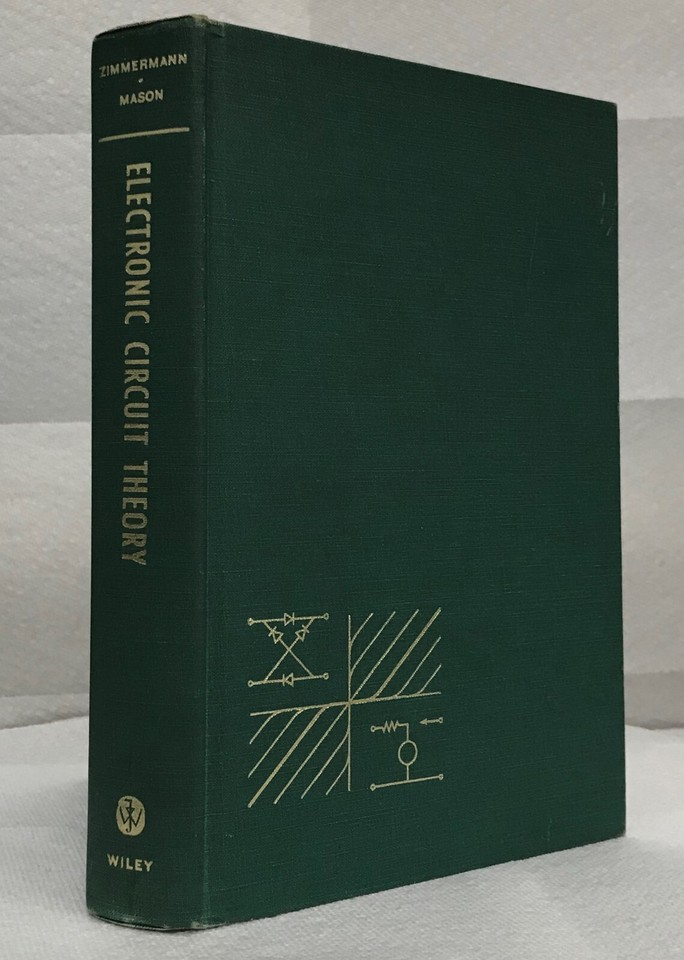

# Revitalized Electronic Circuit Theory: Devices, Models, and Circuits (Henry J. Zimmermann, Samuel J. Mason)
By [Abbas Kohan](https://www.linkedin.com/in/abbas-kohan-59a633368/?isSelfProfile=true) and [M. B. Ghaznavi-Ghoushchi](https://www.linkedin.com/in/ghaznavi-ghoushchi/).

Version 2026.01



A Full redo open-source/Full with Python/ interactive course for all who like to know "What are the basics of electronics circuit design?" from scratch to basic applications.
This is the repo of **Electronic Circuit Theory: Devices, Models, and Circuits for ALL**  project. It brings ALL of **Fundamentals of Electronics** into browser via Python jupyter including examples, plots, equations and simulations.


This project is based on:

1. Python
2. Jupyter notebook and run-able on Google colab
3. schemdraw library
4. PySpice simulation wrapper
5. Good learning resources
6. ... and days and hours of hard work (we did it in about 11 months!)


# Course contents:

1. [[Introduction](chapter.1/chapter1.ipynb)](chapter.1/chapter1.ipynb)
2. [[Electrical Conduction and Diodes](chapter.2/chapter2.ipynb)](chapter.2/chapter2.ipynb)
3. [[Resistive Diode Circuits](chapter.3/chapter3.ipynb)](chapter.3/chapter3.ipynb)
4. [[Rectification and Detection](chapter.4/chapter4.ipynb)](chapter.4/chapter4.ipynb)
5. [[Transistor Models and Circuits](chapter.5/chapter5.ipynb)](chapter.5/chapter5.ipynb)
6. [[Vacuum Triodes](chapter.6/chapter6.ipynb)](chapter.6/chapter6.ipynb)
7. [[Other Control Valves and their Circuit Models](chapter.7/chapter7.ipynb)](chapter.7/chapter7.ipynb)
8. [[Wave Shaping And Amplification](chapter.8/chapter8.ipynb)](chapter.8/chapter8.ipynb)
9. [[Waveform_Generation](Chapter.9/chapter9.ipynb)](Chapter.9/chapter9.ipynb)
10. [[Oscillation in RLC Circuits](chapter.10/chapter10.ipynb)](chapter.10/chapter10.ipynb)
11. [[Symmetray and  Balanced Circuits](chapter.11/chapter11.ipynb)](chapter.11/chapter11.ipynb)
12. [[ Logic Design with MOSFETs 2](chapter.12/chapter.12.ipynb)](chapter.12/chapter.12.ipynb)

# Main features:

# ALL Circuits are drawn via Python in Jupyter
ALL the schematics of the circuits are reproduced utilizing ```schemdraw``` python library.

# Circuit simulation utilizing PySpice
ALL the simulations of the circuits are performed utilizing ```PySpice``` python library.

# Interactive features in circuit draw and simulation
ALL the interactive features in circuit re-draw and parameter modifications are implemented utilizing ```ipywidgets``` python library.

# Circuit explanation utilizing LaTeX
ALL the interactive features in circuit re-draw and parameter modifications are implemented utilizing $LaTeX$ 

# All in one bunch of codes, figures, audio, etc.
ALL of codes, figures, ipynb, docx are ready to download and re-use under the copyright notice verbatim. 

# Unique "Spoon" style of Jupyter Python coding 
We followed stand-alone coding for each example just like insert your spoon in Dessert and eat each section without need to run its upper or lower jupyter cells which usually you see in the most of ```jupyter notebooks``` samples. This enables reader to look at each example as a fully separated and functional code.

# Fully open-source course
The project is totally open-source in hope of help to extended ease of understating for "Fundamentals of Electronics".

# Contents (most) are in Compliance with "Basics of Electronic Circuits - Electronics I"
The contents of this project are ready to use for  second year undergraduate courses like:
 1. Basics of Electronics
 2. Electronics I
 3. Electronic Circuit Theory.


---
## Copyrights and usage terms:
Licensing terms for Project **Revitalized Electronic Circuit Theory: Devices, Models, and Circuits (Henry J. Zimmermann, Samuel J. Mason)**

This project is licensed under the terms of the 3-Clause BSD License (also known as New or Revised or Modified BSD License, or the BSD-3-Clause license), as follows:

Copyright (c) 2026 Abbas Kohan and M. B. Ghaznavi-Ghoushchi. All rights reserved.

Redistribution and use in source and binary forms, with or without modification, are permitted provided that the following conditions are met:
```
Redistributions of any part of this project must retain the above copyright notice, this list of conditions and the following disclaimer. Redistributions in binary form must reproduce the above copyright notice, this list of conditions and the following disclaimer in the documentation and/or other materials provided with the distribution.
Neither the name of the copyright holder nor the names of its contributors may be used to endorse or promote products derived from this software without specific prior written permission.
```

THIS SOFTWARE IS PROVIDED BY THE COPYRIGHT HOLDERS AND CONTRIBUTORS “AS IS” AND ANY EXPRESS OR IMPLIED WARRANTIES, INCLUDING, BUT NOT LIMITED TO, THE IMPLIED WARRANTIES OF MERCHANTABILITY AND FITNESS FOR A PARTICULAR PURPOSE ARE DISCLAIMED. IN NO EVENT SHALL THE COPYRIGHT HOLDER OR CONTRIBUTORS BE LIABLE FOR ANY DIRECT, INDIRECT, INCIDENTAL, SPECIAL, EXEMPLARY, OR CONSEQUENTIAL DAMAGES (INCLUDING, BUT NOT LIMITED TO, PROCUREMENT OF SUBSTITUTE GOODS OR SERVICES; LOSS OF USE, DATA, OR PROFITS; OR BUSINESS INTERRUPTION) HOWEVER CAUSED AND ON ANY THEORY OF LIABILITY, WHETHER IN CONTRACT, STRICT LIABILITY, OR TORT (INCLUDING NEGLIGENCE OR OTHERWISE) ARISING IN ANY WAY OUT OF THE USE OF THIS SOFTWARE, EVEN IF ADVISED OF THE POSSIBILITY OF SUCH DAMAGE.

---

# How to contact us
You can reach us from the following links:


- [Abbas Kohan](https://www.linkedin.com/in/abbas-kohan-59a633368/?isSelfProfile=true)
- [M. B. Ghaznavi-Ghoushchi](https://www.linkedin.com/in/ghaznavi-ghoushchi/)
- [ghoushchi (GitHub)](https://github.com/ghoushchi)
- [YARPOSE - A Dejavu project in EDA (GitHub)](https://github.com/yarpose)

